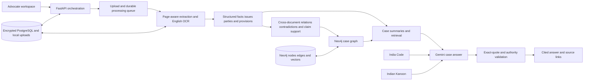

# AI Legal Decision Intelligence Engine Project Report

## Project motivation proposed solution architecture and module implementation

A detailed technical and functional account of the advocate-focused legal case intelligence prototype.

Prepared  08 October 2026

Scope  Indian legal practice, English-language case documents, single-advocate prototype

Status basis  Repository implementation and project plans reviewed for this report

## Executive summary

The AI Legal Decision Intelligence Engine is a case-centered assistant for advocates. It brings multiple case documents into one workspace, extracts source-linked facts and legal references, compares statements across documents, and helps the advocate research law and ask questions about the case. Answers are designed to point back to the uploaded page or paragraph that supports them. The advocate remains responsible for evaluating evidence, legal authorities, and strategy.

The prototype has a working application foundation: single-advocate access, case and document management, local text extraction and English OCR, Gemini-based structured analysis, cross-document candidate comparison, a Neo4j knowledge-graph path, India Code and Indian Kanoon provider integrations, a Gemini case assistant, source citations, summaries, and a Next.js workspace. Some capabilities are partial or depend on runtime configuration and data that are not present in this build. The application does not yet have advocate-labeled case-file data to measure fact, issue, and irrelevant classification quality; its planned NLI verification, rules-based procedural compliance checker, and weighted case-risk analyzer remain future work.

The most important design principle is traceability. Every material case statement should be supported by an exact passage, document name, and page or text locator. The system reports uncertainty when the case record does not answer a question instead of inventing facts. That safeguard can also create an unhelpful fallback when retrieval misses the right passage or generated citations fail exact validation; improving retrieval coverage and measuring answer quality are continuing priorities.

### What this report covers

- The legal-document problem the project addresses and its intended users.
- The proposed end-to-end workflow from advocate sign-in through case analysis and decision support.
- The product modules, their functions, the technologies that perform them, and how the data moves between them.
- Datasets, model-training work, APIs, security controls, implemented functions, and planned capabilities.
- Known limits that matter when evaluating the prototype or planning a research paper.
## Project name and purpose

Project name. AI Legal Decision Intelligence Engine.

Purpose. Provide an advocate with a focused workspace for reviewing a particular matter. The system reads the matter's uploaded documents together, links extracted information to its original source, highlights possible conflicts or unsupported claims, retrieves legal material from selected Indian-law sources, and provides a case-specific chat interface.

The project is intended as research and decision-support software. It is not a substitute for legal advice, professional judgment, witness evaluation, or verification of current law. Its outputs are leads for the advocate to review.

## Problem statement

Advocates commonly work from a case file containing pleadings, affidavits, notices, orders, judgments, contracts, and supporting records. The documents may come from different parties, use inconsistent descriptions, and report events at different levels of detail. A key date may appear differently in two accounts. A claim may be broader than the documents offered in its support. A relevant provision or precedent may be mentioned without enough context to determine why it matters.

Reviewing a growing file manually requires repeated searching and cross-checking. General-purpose chat systems can summarize text, but they can also lose source context, mix allegations with court findings, overlook disagreements between documents, or give legal-sounding statements without a verifiable authority. OCR errors in scanned documents add another risk: the system may appear to have read a page when it has not extracted it reliably.

The engineering problem is therefore to turn a set of heterogeneous case documents into a searchable, source-linked case record; compare related statements across files; surface uncertainty and potential contradictions; and answer questions using only evidence and legal sources that can be shown to the advocate.

## Why the project is being built

- Reduce repeated manual searching across a multi-document case file.
- Make relationships between documents visible, including agreement, added detail, and conflicting accounts.
- Help identify whether the uploaded record supports a claim as stated, supports only part of it, or does not provide a matching passage.
- Keep legal research tied to its source so that an advocate can inspect the statute, section, or judgment before relying on it.
- Make gaps in extraction visible, including unreadable, partially readable, or low-confidence scanned pages.
- Study whether retrieval, structured extraction, and source validation can make a legal assistant more transparent than an uncited general-purpose response.
## Objectives and scope

### Primary objectives

- Create a private workspace for an advocate's matter and its documents.
- Extract searchable English text while retaining document and page-level location information.
- Represent facts, issues, parties, cited provisions, and document relationships in structured form.
- Compare documents and show possible contradictions with source quotes for human review.
- Answer case questions with source passages and link legal research to India Code or Indian Kanoon results.
- Help the advocate decide what to review next without making an autonomous legal or factual determination.
### Prototype boundaries

The current setup is designed for one advocate account and English-language files. The supported intake formats are PDF, DOCX, JPG, PNG, and TIFF. Local Tesseract OCR is the configured OCR path. Cloud OCR is a future provider option. Authentication, encrypted storage, and production checks exist, but a fully managed multi-user production service, billing, complete retention policy, disaster recovery, and organization-wide access control are outside the current prototype scope.

## Proposed solution

The proposed system uses a web application to manage cases and uploads, a Python API to coordinate extraction and analysis, a relational database for case state, a graph database for linked case concepts, Gemini for language tasks, and external Indian legal sources for research. Every stage keeps references to the original file location so that later outputs can be checked.

The workflow starts when the advocate signs in and creates a matter. The advocate uploads one or more documents. The backend classifies each file, extracts embedded text or runs OCR, cleans the result, and records coverage and confidence. Structured extraction then finds facts, issues, entities, dates, amounts, and legal references. Cross-document analysis finds candidate relationships and contradictions. Those results can be organized in a knowledge graph. The advocate can then generate a case summary, ask the case assistant a question, or search legal sources. The assistant returns only statements that pass source validation, with citations that open the relevant text.

Figure 1. Case document processing and source-grounded answer flow.

## System architecture and data flow

Presentation layer. The Next.js application provides sign-in, case lists, matter workspaces, document controls, analysis views, legal research, knowledge graph, summary, and case chat.

Application layer. FastAPI provides authenticated case endpoints and coordinates upload processing, structured analysis, summaries, graph creation, legal-source search, and chat. A database-persisted job queue lets the worker resume or reclaim pending work after an API restart.

AI and analysis layer. PyMuPDF, python-docx, Pillow, and Tesseract extract source text. Gemini performs language extraction, classification, relation analysis, summaries, and chat generation. Rules provide deterministic extraction for common legal references, dates, amounts, and citations. Embeddings help identify candidate relationships and retrieve graph nodes.

Data layer. PostgreSQL stores case metadata, processing state, encrypted extracted text, analysis, chat, and summaries. Uploaded bytes are encrypted at rest under the local upload directory. Neo4j stores case-scoped graph nodes, relationships, and vector properties. India Code and Indian Kanoon supply legal research results when an advocate searches.

A document passes from upload to readable text, from readable text to structured items and analysis, and then to graph, search, summary, or chat. The legal research providers are a separate authority source; the system should not treat a document's mention of a section as proof of the section's current legal text.

## How module numbering is reconciled

The project materials use two module schemes. The advocate-facing product plan numbers the major capabilities from case workspace through the case assistant. The technical solution document numbers internal AI components such as retrieval and verification. They describe different levels of the same system. For example, product Module 4 means legal research, while technical Module 4 means grounded retrieval. This report uses the product module numbers for the main implementation walkthrough and labels the technical components separately.

| Product module | Advocate-facing capability | Technical components it uses |
| --- | --- | --- |
| 1 | Sign-in, case workspace, document intake and extraction | Technical 1 and part of Technical 9 |
| 2 | Structured extraction, cross-document analysis, contradiction and claim support | Technical 2 and part of Technical 6 |
| 3 | Case knowledge graph and relationship search | Technical 3 and graph-assisted Technical 4 |
| 4 | Indian legal research | Provider integration and source retrieval |
| 5 | Case-specific chatbot with grounded citations | Technical 4, 5, 6 and 9 |
| Cross-cutting | Case summary, advocate dates, decision-support views | Technical 5, 7 and 8 where implemented |

## Product modules and implementation

### Module 1 Advocate access case workspace and document intake

Goal. Give the advocate a protected matter workspace and convert uploaded files into searchable, page-linked text.

Current status. Implemented in the prototype. Local readiness depends on the database, API, worker, file system, OCR binary, and required environment settings being available. Production settings remain operator-specific.

#### Functions and features

- Create the single advocate account, sign in and out, and protect case APIs using an HttpOnly SameSite Strict session cookie. Write requests are checked for same-origin behavior and login attempts are throttled.
- Create, edit, list, and delete case matters. Keep each document, analysis, summary, graph, legal search, and conversation scoped to its case.
- Upload multiple supported files: PDF, DOCX, JPG, PNG, and TIFF. File size, number of files, per-case document count, and storage limits are enforced.
- Extract PDF text by page, read DOCX paragraphs and supported structures, and perform English OCR for scanned PDFs and images. Supported embedded attachments are bounded by size, nesting, and count.
- Normalize Unicode and whitespace, conservatively remove repeated margin text and page numbering, retain locators and source spans, and track OCR confidence.
- Show which documents and locations are readable, blank, low-confidence, failed, or awaiting review. Require the advocate to retry, review, or acknowledge incomplete sources before analysis.
- Encrypt sensitive database fields and uploaded bytes. Production setup requires a stable backed-up encryption key, advocate credentials, TLS database settings, and ClamAV malware scanning.
#### Technologies and their roles

- Next.js, React, TypeScript, Tailwind CSS, and lucide-react provide the web interface.
- FastAPI and Pydantic implement the application API; SQLAlchemy and psycopg connect Python to PostgreSQL; Alembic versions database changes.
- PyMuPDF extracts PDF content and attachments; python-docx reads Word content; Pillow handles image input; pytesseract calls the local Tesseract OCR executable.
- AES-256-GCM encryption protects stored case content. Scrypt hashes the configured advocate password. The current prototype supports one advocate account.
- A PostgreSQL-persisted queue and a single API worker handle document, analysis, summary, and graph jobs. Docker Compose runs PostgreSQL and Neo4j locally.
- ClamAV is required for production uploads. OCR confidence defaults to a 70 percent review threshold. English OCR is the current supported language.
How it connects. The website sends the file to the authenticated API. The API stores encrypted bytes, creates a durable processing record, and the worker extracts text and location metadata. The extracted locations are written into PostgreSQL; the UI reads status and coverage from the API before allowing later analysis.

Limits and remaining work. Cloud OCR, additional languages, multi-advocate roles, automatic retention expiry, and a complete production deployment and disaster-recovery setup are not part of the current prototype. The app's local security controls do not by themselves establish production readiness.

### Module 2 Structured extraction and cross-document analysis

Goal. Turn raw document text into source-linked facts, issues, entities, provisions, and candidate relationships that later modules can search and explain.

Current status. Partially implemented. Gemini, rules, sentence segmentation, source offsets, analysis runs, cross-document candidate retrieval, contradiction findings, and claim-support views exist. Accuracy for advocate pleadings and affidavits is not yet measured because the required human-reviewed target corpus is absent.

#### Functions and features

- Split text into sentence-sized records while retaining document ID, page or paragraph locator, and exact start and end character offsets.
- Use Gemini structured output to extract factual statements, classify sentences as fact, issue, or irrelevant, and identify people, organizations, courts, legal roles, amounts, dates, and legal references.
- Apply regex and deterministic rules as backstops for common dates, INR values, section and rule references, statute names, and Indian case citations.
- Carry OCR confidence and review flags into extracted items so low-quality source material is not silently treated as certain.
- Find possible cross-document links and contradictions using topic/value matches, lexical overlap, and Gemini Embedding 2 cosine similarity. Ask Gemini to judge candidate pairs and retain the source quotes.
- Compare advocate-entered claims with extracted facts and classify the available evidence as supported, partially supported, or unsupported, with a possible-overstatement flag.
- Let an advocate review or correct selected findings, with corrections kept separate from source evidence.
#### Technologies and their roles

- Gemini API and the Google Gen AI SDK perform extraction and sentence classification; model and data tier are configured in the backend environment.
- The configured generation model is gemini-3.8-flash. Gemini Embedding 2 supplies semantic candidate similarity for cross-document comparison; vectors for that comparison are computed in memory and discarded after the run.
- Python sentence-boundary logic protects common legal abbreviations and decimals and preserves end-exclusive source offsets. Regex legal extraction provides deterministic backstops.
- SQLAlchemy and PostgreSQL store encrypted source-linked analysis results. Evidence locators connect the UI back to extracted document text.
- An optional seven-label legal sentence-role classifier uses a frozen law-ai/InLegalBERT encoder with a trained linear head. It classifies judgment rhetoric, not fact, issue, or relevance to an individual case.
How it connects. Module 1 supplies cleaned page or paragraph text and source identifiers. Module 2 adds structured records tied to the same source location. Candidate relationships and contradiction findings feed Module 3 and the assistant. The UI uses these results for issue lists, claim-support review, and source navigation.

Limits and remaining work. A public KING NER corpus exists for benchmark evaluation, but it is not the fact/issue/irrelevant dataset required for target pleadings and affidavits. The OpenNyAI legacy NER result was weak on KING and its spaCy 3.2 runtime is retired. Synthetic examples are prompt-development material, not a gold dataset. Gemini confidence is uncalibrated, and candidate retrieval can miss relevant pairs. Gemini free-tier use is restricted to development/test with synthetic or fully redacted documents; paid tier is required before confidential case text is sent.

#### Dataset and model position for Module 2

| Resource | What it contains | Use and limitation |
| --- | --- | --- |
| KING Indian Court Decision Annotated Corpus | 50 Supreme Court judgments, 77,927 tokens, 1,062 annotated exact entity spans; CC BY 4.0. | NER benchmark only. The explicit OpenNyAI coarse mapping covers 576 of 1,062 gold spans; legacy exact-span scores were precision 0.133, recall 0.217, F1 0.165. It does not evaluate pleadings or sentence relevance. |
| Supreme Court sentence-role corpus | 9,380 sentences from 50 judgments, with seven rhetorical-role labels. | Used to train/evaluate the optional seven-role classifier. The encoder is frozen and only a linear head is trained. Held-out accuracy 0.452 and macro F1 0.319 across ten documents. These labels do not mean fact, issue, or irrelevant for an advocate's matter. |
| Synthetic fact/issue seed | 24 balanced invented examples written in pleading/affidavit style. | Prompt development and schema checks only. It is not extracted from filed legal documents and is not an accuracy dataset. |
| Advocate-reviewed pleadings and affidavits | No project gold set is present yet. | Needed to evaluate target document extraction and fact/issue/irrelevant classification, estimate precision and recall, and calibrate confidence. Keep the train/dev/test split separate by case or document. |

The optional InLegalBERT sentence-role model files are present in the local runtime, but the API startup log reported that PyTorch was missing when the classifier tried to load. Its inference path is therefore not confirmed in the current backend environment. This model solves a different task from the requested case-specific fact/issue/irrelevant classification.

### Module 3 Case knowledge graph

Goal. Represent the case's source-linked facts, issues, evidence, parties, and legal references as nodes, then connect supported relationships so an advocate can explore the record across documents.

Current status. Implemented as a graph build and search path, with runtime verification still important. Neo4j storage, case-scoped search, graph UI, local embeddings, rule-based candidate generation, and Gemini-assisted relation classification are present. Recent runtime logs also recorded relation-classification TypeErrors and cases without a completed graph run.

#### Functions and features

- Create source-linked nodes for extracted facts, issue sentences, evidence locations, explicit parties, and provisions.
- Use existing Module 2 relations and source evidence to establish supports, contradicts, applies-to, or unrelated candidate edges.
- Use deterministic candidate filters first; ask Gemini to classify ambiguous relationships rather than every possible node pair.
- Store text embeddings beside graph nodes and allow a case-scoped hybrid search to return node text, source locators, and adjacent relationship context.
- Display the graph in the case workspace so the advocate can inspect connected facts and their original passages.
#### Technologies and their roles

- Neo4j 5.26 Community stores case graph nodes, edges, and vector properties, queried with Cypher.
- Sentence-Transformers with all-MiniLM-L6-v2 generates normalized 384-dimensional node embeddings locally; the first model use may require downloading weights from Hugging Face.
- Gemini classifies selected ambiguous graph relationships using structured output; it is not asked to invent unsupported facts.
- PostgreSQL stores the encrypted graph snapshot and run metadata used by the website. The graph search endpoint scopes results to a case and graph run.
How it connects. A completed Module 2 run provides the source facts and issues. The graph processor creates nodes, edges, and vectors in Neo4j and saves a case snapshot. The workspace reads the snapshot and search endpoint; chat may use graph search as an additional retrieval source.

Limits and remaining work. A graph run depends on the current analysis run, Neo4j credentials and availability, the local embedding runtime, and Gemini availability for ambiguous pairs. A failed or stale graph must not be presented as current. Recent TypeErrors need resolution and a fresh graph build before claiming the graph is reliable for every case.

### Module 4 Indian legal research

Goal. Let an advocate search selected Indian legal sources and inspect the provision or judgment behind a suggested legal point.

Current status. Implemented as separate India Code and Indian Kanoon provider paths, search UI, query and detail operations, and guarded use of provider results in the case assistant. Provider availability and current-law accuracy still depend on the source response and advocate review.

#### Functions and features

- Search India Code for statutes, provisions, and statutory mappings. The API is read-only JSON and does not require authentication.
- Search Indian Kanoon for reported judgments and retrieve available judgment detail, metadata, citations/cited-by material, and query-matched passages.
- Allow the advocate to inspect a legal research result and choose whether to use its text for an AI-generated research note.
- Allow a case assistant answer to cite supplied India Code results when it makes a legal proposition. Keep provider results distinct from case-document evidence.
- Isolate provider failures so an unavailable legal source does not erase a valid source-cited description of the uploaded case file.
#### Technologies and their roles

- India Code JSON API at https://indiacode.ecourtsindia.com/api/v1. No API key is required.
- Indian Kanoon API at https://api.indiankanoon.org. The backend supports the configured API token or RSA private-key signing and customer-email identity; keys remain server-side.
- FastAPI and httpx implement provider clients, pagination, filters, timeouts, caching, and per-case rate limits.
- Gemini can prepare a research note from selected retrieved passages. Quotations are validated against the passage text before they are shown as source-backed.
How it connects. Module 2 can identify a provision or issue mentioned in the case. The advocate can launch a legal-source search. India Code and Indian Kanoon results return through their own provider adapters, then the UI displays them separately from uploaded evidence. The chat can use retrieved India Code material for a legal answer when a legal question is asked.

Limits and remaining work. A provision mentioned in a judgment or pleading is not automatically the current text of the law. Advocates must verify amendments, jurisdiction, precedential status, and current applicability. India Kanoon API terms and plan limits apply; no blanket corpus copy is stored in the application.

### Module 5 Case-specific assistant and grounded retrieval

Goal. Answer an advocate's question using the current case record and, when needed, cited legal-source results; return document citations that can be checked in place.

Current status. Implemented as a Gemini-backed assistant with case-scoped conversation storage, exact-quote citation validation, structured context, and safe fallbacks. Retrieval is mixed: lexical BM25, structured analysis, summaries, graph search when available, and source fusion. Broad overview retrieval was recently expanded in code for short files, but that change has not yet been live-verified in the running website.

#### Functions and features

- Create, list, rename, delete, and continue conversations within a case.
- Retrieve passages from all readable documents, the structured case index, verified summary passages, advocate reviews, and graph results when available.
- Send the selected context, legal-source results, and latest question to Gemini with instructions to separate allegations, recorded events, and court findings.
- Require every material case statement to have a source unit and exact quote. Require legal statements to cite the supplied India Code result. Drop statements that fail these checks.
- Answer only from the available record when it supports the question. State when a source does not contain the requested fact and ask a follow-up question when current case status is needed.
- Show source file, page or locator, and quote; link a citation back to the extracted text.
#### Technologies and their roles

- Gemini API through the Google Gen AI SDK generates structured JSON answers; Gemini readiness and data tier are checked before use.
- BM25 lexical ranking is the primary local passage retriever. Context from graph, summary, reviews, and structured findings is fused and limited to a bounded number of passages.
- Neo4j hybrid graph search can add semantically similar and related nodes when a current graph exists.
- The prompt and citation validator preserve source integrity: exact quotes must be present in the original extracted text, and the displayed answer is assembled from accepted cited statements.
- India Code and Indian Kanoon are separate legal sources. Legal-source requests do not send case names, dates, or amounts as free-form India Code query content when building the compact query.
How it connects. The assistant receives the advocate question, case-scoped evidence, any current structured analysis and summary, graph findings, selected legal-provider results, and recent conversation. Gemini writes a structured answer. The backend validates every citation against PostgreSQL or provider results before saving the answer to the conversation and returning it to the UI.

Limits and remaining work. Gemini is an API model guided by the project's legal prompt; it is not a custom model fine-tuned on the entire Indian case corpus. The assistant can fail closed when retrieval misses a passage or a citation does not validate. FAISS/Weaviate, cross-encoder reranking, and NLI-based statement verification are not in the active chat stack. A judgment cannot reliably specify the advocate's next current step if the latest order or current procedural stage has not been supplied.

### Cross-cutting case summary

The summary feature is generated across all readable case documents. Large matters are summarized in batches and then integrated. Narrative and structured points retain source filename, page or paragraph locator, and a quote checked against the extracted text. The summary is an aid for navigation; the chat should verify claims against the original passages. A stale summary is not used as if it covers a document uploaded later.

Technologies. Gemini produces structured summary drafts; Python orchestration combines batches; PostgreSQL stores encrypted summary JSON and source references; the React case workspace renders summary sections and their citations.

### Cross-cutting decision support and advocate dates

The prototype supports advocate-entered claims and evidence review and includes a matter dates agenda where the advocate can add, complete, reopen, and remove dates. The dashboard can show dates that are overdue or due within seven days. It does not calculate court deadlines from procedural statutes and does not automatically send reminders. The advocate should confirm all deadlines against the applicable rules and court orders.

## Technical solution components

The technical solution document divides the AI core into retrieval, answer generation, claim verification, procedural compliance, evidence-gap and risk analysis, and user interface components. These components map to the product modules above but have different numbering.

| Technical component | Purpose | Status in this prototype |
| --- | --- | --- |
| T1 Document ingestion | Read PDF, DOCX and image files; clean text and keep page metadata. | Implemented with local English OCR and visible extraction coverage. |
| T2 Structured extraction | Extract entities, facts, issues, provisions and source offsets. | Gemini and regex implemented; advocate-labeled target evaluation is missing. |
| T3 Knowledge graph | Create nodes and relationships from T2 results; attach embeddings. | Neo4j path implemented; runtime graph build failures have been observed and must be rechecked. |
| T4 Grounded retrieval | Find passages and connected case concepts for a question. | BM25, structured and graph/summary fusion exist. FAISS or Weaviate and cross-encoder reranking are planned, not active. |
| T5 Answer generation | Generate structured responses from retrieved context. | Gemini JSON answer generation and conversation UI are implemented. |
| T6 Claim verification | Verify each answer claim against its cited passage using embedding and entailment signals. | Exact quote/citation validation and claim-support indicators exist. NLI entailment, calibrated scores and complete verified/flagged claims are not implemented. |
| T7 Procedural compliance | Evaluate rules for a selected case type against graph evidence and dates. | Planned. No validated case-type checklist or procedural rule engine is present. |
| T8 Evidence gap and risk | Aggregate issue evidence and compliance results into an explainable case-risk view. | Claim evidence support is partial. Weighted risk scoring and a validated risk summary are planned. |
| T9 User interface | Expose the workflow, chat, citations, flags, and review panels. | Next.js workspace and case surfaces are implemented; end-to-end and production checks remain. |

### Retrieval engine and FAISS status

The technical proposal originally described embedding the user query, retrieving candidates with FAISS or Weaviate, traversing the knowledge graph, merging candidates, and reranking them with a cross-encoder or an LLM scoring pass. In the current application, case chat primarily uses local BM25 term ranking and fuses selected structured, summary, review, and graph passages. Neo4j graph search uses graph-node vectors and lexical overlap where the graph exists. Gemini Embedding 2 is used for candidate-pair discovery in cross-document analysis, with run-scoped embeddings held in memory.

FAISS and Weaviate are not installed or used in the current chat pipeline. The PostgreSQL service uses a pgvector-enabled Docker image, but the case assistant does not currently rely on a persisted pgvector index as its primary question retriever. A future vector-search implementation should be evaluated against lexical retrieval and should retain case isolation and source-locator checks.

### Claim verification NLI and confidence

The technical proposal calls for checking every answer claim against its cited passage using both embedding similarity and a natural-language-inference model such as RoBERTa-MNLI. The NLI model would classify whether a source entails, contradicts, or does not establish the claim. A combined score would then be calibrated on a labeled evaluation set and used to mark claims verified or flagged with an explanation.

The current software implements important but narrower safeguards: an answer must contain a statement tied to a source quote that exactly occurs in the cited text; case documents are separated from law-provider results; and unsupported text is removed or replaced by an uncertainty response. These rules are citation validation, not a semantic entailment model. They do not establish a calibrated probability that a sentence is true. NLI, similarity-based answer-claim scoring, threshold calibration, and an evaluation set for verified/flagged decisions remain future work.

### Procedural compliance and risk analysis

The technical plan describes a rules checklist for one chosen case type, with required procedural documents, evidence patterns, and date logic. The rule engine would compare checklist items with graph nodes and return satisfied, missing, or unclear states plus source references. A separate risk analyzer would count support for each issue, combine evidence-gap results with compliance findings, and produce a weighted risk summary from explicit structured factors.

These are not complete modules in the current prototype. A reliable implementation needs an advocate and legal-domain expert to choose the first case type, review each checklist against current authoritative rules, define date calculations and exceptions, and approve a held-out evaluation set. The application currently manages manually entered dates but does not calculate legal deadlines. Its claim-support panel is a limited evidence indicator and should not be described as a case outcome prediction or full risk score.

## Technology stack and function

| Layer | Technology | Role in the system |
| --- | --- | --- |
| Web application | Next.js 16.3, React 19, TypeScript, Tailwind CSS 4, lucide-react | Renders authentication, case workspace, uploads, extraction coverage, graph, summary, research, decision-support and chat views. |
| API and orchestration | FastAPI 0.129, Uvicorn, Pydantic, Python 3.12 | Validates requests, applies access rules, coordinates background work, extraction, analysis, legal research and chat. |
| Database access and migrations | SQLAlchemy 2, psycopg 3, Alembic | Reads and writes case/document/job records and applies versioned schema changes. |
| Relational storage | PostgreSQL 18 with pgvector-enabled image | Stores encrypted case metadata, extracted text, analysis, summaries, conversations, job state and graph snapshots. pgvector is available in the local image; it is not the current primary chat index. |
| Graph storage | Neo4j 5.26 Community and Cypher | Stores graph nodes, edges, and 384-dimensional node vectors for case-scoped graph search. |
| PDF and Word extraction | PyMuPDF, python-docx | Reads page-aware PDF text and supported attachments; extracts DOCX paragraphs and supported document structures. |
| OCR and image handling | Tesseract, pytesseract, Pillow | Runs local English OCR on scans and images; converts OCR confidence into review status. |
| Language model | Google Gemini API and google-genai SDK | Performs structured extraction, sentence categories, candidate relation judgments, summaries, and case chat when configured. |
| Embeddings | Gemini Embedding 2; Sentence-Transformers all-MiniLM-L6-v2 | Gemini embeddings screen cross-document fact pairs; local MiniLM vectors enrich Neo4j graph search. |
| Legal sources | India Code API; Indian Kanoon API | Supplies statutory text/mappings and reported case-law search/detail material through separate provider clients. |
| Security | AES-256-GCM, signed HttpOnly cookies, scrypt, same-origin checks, ClamAV | Protects stored content and advocate sessions, checks writes, and scans files for malware in production configuration. |
| Local infrastructure | Docker Desktop and Docker Compose | Runs PostgreSQL and Neo4j services for local development. |
| Quality tools | pytest, ESLint, Next.js build | Support backend tests, TypeScript/React linting and frontend build checks. Their inclusion does not imply every test has passed for this report. |

## How the technologies work together

1. The advocate signs in through the Next.js site. The signed session cookie accompanies same-origin API requests; the backend checks ownership before returning a case or document.
1. The browser sends one or more supported files to FastAPI. Upload controls and ClamAV configuration are checked. Encrypted file bytes and a durable processing record are created.
1. The background worker extracts PDF and DOCX text or invokes Tesseract for scanned pages and images. Each result retains a document identifier and page or text-location reference.
1. The UI receives extraction coverage and review state. An advocate resolves or acknowledges incomplete sources before asking the system to analyze the case.
1. Gemini and deterministic rules create structured facts, issues, entities, provisions, dates, amounts, source offsets and confidence estimates. The database stores encrypted analysis results.
1. Cross-document retrieval finds candidate related facts. Gemini assesses selected candidate pairs and creates possible contradictions or relationships. The advocate can review the source quotes.
1. A graph run converts structured items and relationships into Neo4j nodes and edges and stores local embedding vectors. The case workspace can display the graph and search its nodes.
1. The advocate searches India Code or Indian Kanoon when legal authorities are needed. Provider responses remain distinct from uploaded evidence and are shown with their source attribution.
1. For a chat question, the backend retrieves case passages and available structured, summary, graph, and legal context. Gemini returns structured answer statements and citation metadata.
1. Before displaying the answer, the backend verifies that each case quote occurs in the source text and that legal citations match the supplied provider result. The UI displays accepted statements and links to the source location.
## Data models and datasets

The application uses two kinds of data. The operational case data comes from the advocate's uploaded files, case details, optional advocate claims, and review notes. Model and evaluation data are kept separate from client files and are used to develop or measure individual NLP tasks.

| Data type | Current source or status | Where it is used |
| --- | --- | --- |
| Case file documents | Advocate uploads in supported formats; stored locally with encryption and source locators. | Extraction, structured analysis, contradictions, summaries, graph, legal research prompts and chat retrieval. |
| KING NER corpus | Public, licensed judgment corpus with 50 documents and 1,062 entity spans. | Exact-span NER benchmark. It is not a pleading/affidavit benchmark and does not label fact/issue/irrelevant. |
| Sentence-role corpus | 9,380 Supreme Court judgment sentences from 50 documents; seven rhetorical classes. | Train/validation/test for the optional InLegalBERT sentence-role model. |
| Synthetic examples | 24 synthetic fact/issue examples. | Prompt development and schema checks only; not a gold or real-world evaluation set. |
| Pleading and affidavit annotation set | Not yet supplied or created from advocate-reviewed real documents. | Needed to measure target-domain extraction, sentence classification, entity extraction, contradiction screening, and calibration. |

The seven-label sentence-role classifier is a separate trained model from Gemini's case-specific fact/issue/irrelevant classification. Its held-out macro F1 is 0.319 on judgment rhetorical roles. That result must not be presented as fact/issue/irrelevant accuracy or as performance on pleadings and affidavits.

## Security and data handling

The prototype has application-level safeguards for a local single-advocate installation. Case APIs require authentication; sessions use an HttpOnly SameSite Strict cookie and a signed secret; password hashes use scrypt; writes are checked for same-origin requests; and login attempts are rate-limited. Selected case fields, extracted text, analysis, summary data, uploaded file bytes, and graph snapshots are encrypted with AES-256-GCM. The encryption key must remain stable and have a separate secure backup. A lost key can make encrypted data unreadable.

Production startup is intended to fail unless the encryption key and backup confirmation, advocate credentials, PostgreSQL TLS with certificate verification, and a working ClamAV scanner are configured. Production Neo4j use also requires verified TLS and confirmation of encrypted storage. These checks are configuration gates; they do not constitute an independent security audit or legal compliance certification.

Gemini API data tier matters because case text may be sent to Google for model processing. Development/free-tier settings are intended for synthetic or redacted files. A paid, billing-enabled configuration and review of current provider terms are required before sending confidential case material. India Kanoon API credentials and RSA private-key material must remain in backend configuration and must never be added to source control or printed in logs.

## Evaluation strategy

A research evaluation should test each component separately and then measure the integrated user workflow. The existing KING corpus can measure a judgment-domain NER baseline under its explicit coarse label mapping. The sentence-role corpus supports the separate seven-role classifier. Neither dataset measures advocate-facing fact/issue/irrelevant labels on pleadings and affidavits.

| Evaluation area | Measure | Evidence still required |
| --- | --- | --- |
| Document extraction | Readable-page coverage, OCR review rate, extraction failures and locator correctness. | A representative set of digital PDFs, scanned PDFs, DOCX files, images and attachments with human-checked expected text/coverage. |
| Structured extraction | Precision, recall and exact-span F1 by entity/fact type; sentence-class macro F1. | Advocate-reviewed annotations from target pleadings and affidavits, with written labeling guidance and case-disjoint splits. |
| Contradiction detection | Candidate recall, precision after advocate review, false-positive categories and evidence-pair coverage. | Cases with adjudicated cross-document relation labels, including contradiction, support, repeat, additional detail and unrelated pairs. |
| Retrieval and citations | Recall@k, citation correctness, answerability decisions, source coverage and latency. | Question-answer-source triples reviewed by advocates, including overview, event, person, date, legal provision and unanswerable questions. |
| Claim verification | Entailment/contradiction/unknown metrics and calibrated confidence. | NLI implementation plus independently labeled answer-claim-passage examples and held-out cases. |
| User workflow | Task completion, review time, source navigation success, and recoverability from processing errors. | Observed end-to-end sessions with advocates and a documented synthetic/redacted test case. |

Do not tune thresholds on the same cases used to report final results. Split by case or document to prevent sentences from the same judgment appearing in both training and test partitions. Report dataset size, label mapping, missing labels, OCR status, and uncertainty with every metric.

## Implementation status and remaining work

| Capability | Status | Why it matters next |
| --- | --- | --- |
| Authentication, case management, uploads, local extraction and coverage | Implemented in code; live setup depends on runtime readiness. | Foundation for safe downstream analysis and case isolation. |
| Structured facts, issues, parties and legal references | Implemented with Gemini/rules; quality evaluation partial. | Every downstream relationship and assistant answer depends on correct source-linked extraction. |
| Cross-document contradiction and claim-support analysis | Implemented as candidate/review workflows; measured precision/recall missing. | Important research focus; advocate labels needed to quantify reliability and tune thresholds. |
| Knowledge graph and graph search | Implemented code path; recent graph processing TypeErrors and missing completed runs observed. | Resolve runtime failures and verify current graph build, persistence and case-scoped retrieval. |
| India Code and Indian Kanoon research | Provider integrations implemented; each external request still depends on provider/API availability. | Authority text, amendments and precedential weight require advocate review. |
| Gemini case assistant | Implemented with strict exact-quote validation; broad overview retrieval was recently improved in code, not live-verified. | Improve recall and answer coverage without relaxing source-grounding safeguards. |
| FAISS or Weaviate vector index | Planned, not used by chat. | Would provide semantic question retrieval; compare against BM25 and graph search before adoption. |
| Cross-encoder reranker | Planned, not active. | Could improve ranking after candidate retrieval if benchmark results justify model cost and latency. |
| NLI claim verifier | Planned, not implemented. | Would add semantic entailment checking beyond exact quote validation. |
| Advocate-reviewed case-file gold data | Missing. | Required for target-domain quality claims, calibration, and fair research evaluation. |
| Procedural compliance rules | Planned; requires case-type and legal-expert input. | Rules are jurisdiction/case-type specific and can become stale when law changes. |
| Weighted evidence-gap and risk analysis | Planned beyond current claim-support indicators. | Needs explicit rules, accepted weights, validation cases, and explanation policy. |
| Multi-advocate and production operations | Not complete. | Needs roles, tenancy, operational backups, retention, monitoring, incident response and deployment controls. |

## Recommended implementation sequence

1. Restore and verify a clean local end-to-end run: sign in, create a case, upload a synthetic or redacted multi-document file, inspect coverage, run analysis, inspect contradictions, build the graph, create the summary, search a provision, and ask cited chat questions.
1. Repair graph relation-classification errors and rerun a fresh graph build. Confirm node count, relationship types, vector properties, case isolation, and source locators through the API and UI.
1. Prepare advocate annotation guidance and a consented, case-disjoint dataset for fact, issue, irrelevant, entities, and cross-document relation labels. Keep synthetic examples out of final accuracy calculations.
1. Run retrieval and citation evaluations against a reviewed question set. Compare BM25, graph-assisted retrieval, and a proposed vector index before selecting FAISS, pgvector, or another store.
1. Implement claim-level NLI verification after the evaluation data is ready. Calibrate thresholds on development data, freeze them, then report final held-out metrics.
1. Choose one case type and jurisdiction for the first procedural checklist. Have a legal expert validate each rule, exception, date calculation, and source before implementing compliance and risk modules.
1. Complete security, retention, backups, monitoring, multi-user access, operational deployment and accessibility review before accepting confidential matters from multiple advocates.
## Conclusion

The project combines document processing, source-linked legal extraction, cross-document analysis, a case graph, selected Indian legal research providers, and a Gemini case assistant in one advocate workflow. The prototype already contains substantial application and AI functionality. Its central research claim still needs measured evidence: the software must show that its extraction, contradiction screening, retrieval, and answer verification are reliable on advocate-reviewed case files.

The next milestone should be a repeatable synthetic or redacted end-to-end demonstration with explicit coverage reporting and current runtime checks, followed by a consented annotation set for the target document types. NLI verification, procedural compliance, risk scoring, and semantic vector retrieval should be added only with clear evaluation criteria and source-grounded explanations.

## Project reference files

- README.md: current setup, workflow, security, module descriptions and configuration notes.
- AI_Legal_Case_Intelligence_Technical_Solution.md: proposed technical architecture and Modules 1 through 9, including FAISS/Weaviate, NLI verification, procedural compliance, risk analysis and UI integration.
- backend/evaluation/README.md: KING NER benchmark, label mapping, OpenNyAI baseline and pleading annotation requirements.
- backend/evaluation/README_sentence_roles.md: Supreme Court sentence-role dataset and optional InLegalBERT classifier training/evaluation.
- backend/app/api and backend/app/services: current application endpoints and processing services.
This report distinguishes implemented code from runtime verification and future work. Status is a project snapshot, not a guarantee that every external service or local environment is available at the time of use.
