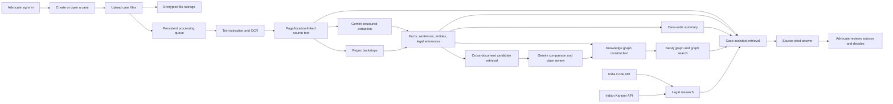

# AI Legal Decision Intelligence Engine

## Implemented System and Model Report

**Repository:** `Z:\BR14\LEGAL ENGINE PATENT`  
**Audit date:** 8 October 2026  
**Scope:** This is an inventory of functionality present in the current source tree, model artifacts, configuration, and local development environment. It documents the implemented prototype, not the desired roadmap. A feature can exist in code while a model dependency, external service, or local process is unavailable; those states are identified separately.

---

## 1. Project identity

### Project name

**AI Legal Decision Intelligence Engine**

### Problem addressed

An advocate working on a matter may need to read many pleadings, affidavits, orders, judgments, and supporting records. The case information is spread across those files. Important facts can be repeated with differences, legal references can be difficult to track, and a broad question about the whole file can be hard to answer quickly while preserving a verifiable connection to the source page.

### Implemented solution

The current prototype provides a single-advocate, case-centred workspace. It stores case documents, extracts page- or location-linked text, uses Gemini and deterministic rules to structure parts of that text, identifies selected cross-document relationships and discrepancies, builds a case knowledge graph, queries India Code and Indian Kanoon, generates a source-cited summary, and provides a case-specific chat interface. The interface links findings and answers back to source documents and exposes review states so the advocate can inspect the evidence.

The software is decision support. Its generated classifications, findings, summaries, and research leads are candidate analysis for advocate review; they do not establish that an allegation is true or decide a case.

---

## 2. Current system at a glance

The worker uses persisted statuses in PostgreSQL. The current implementation runs one worker loop in the API process and takes the oldest queued job across document extraction, case analysis, summary, and graph construction. The worker recovers interrupted `processing` records after restart. This gives the prototype durable job state; it is still a single sequential worker.

---

## 3. Product modules implemented

The repository's product-module numbering is used below: **1 case workspace and intake, 2 structured extraction and cross-document analysis, 3 case knowledge graph, 4 Indian legal research, and 5 case assistant**. Case summary, decision-support presentation, and the dates agenda are implemented workspace features that connect to those modules.

### Module 1 — Advocate access, case workspace, document intake, and extraction

#### User-visible functions

- Single-advocate first-run setup, sign-in, session check, and sign-out.
- Case list in list/grid layouts, create case, open case, edit case details, and delete case.
- Case metadata fields include title and optional matter/case reference, type, court, jurisdiction, and stage.
- Multi-file upload, document replacement, document deletion, file download/view, extraction retry, and document label/description editing.
- Upload and processing statuses are shown separately; the case screen displays extraction coverage and review conditions.
- Source text preview groups extracted text by page or extraction location. Citations can open the corresponding extracted source passage.
- Near-duplicate document detection produces a review warning. It does not change or discard files.
- The date agenda allows an advocate to add, complete/reopen, edit, and remove dates. The case dashboard surfaces dates that are overdue or due within seven days.

#### Accepted input and extraction behavior

- File types: PDF, DOCX, JPG, PNG, and TIFF.
- Configured limits: 50 MB per file, 10 files per batch, 200 documents per case, and 1 GB stored per case.
- Digital PDF text is extracted page by page. PDF attachment annotations and supported catalog attachments are also inspected within configured limits.
- DOCX extraction reads paragraphs, tables, headers, footers, notes, comments, and supported embedded PDF/DOCX/image attachments.
- Scanned PDF pages and images use local English Tesseract OCR. OCR confidence and extraction method are stored with each source location. Low or missing OCR confidence is marked for review and is used to qualify downstream facts and findings.
- Text cleanup normalizes Unicode and whitespace and removes clearly repeated page headers, footers, and page numbers. It also handles common repeated OCR edge lines. Cleanup is deliberately limited to patterns identified as page furniture.
- Coverage reports distinguish readable, partially readable, unreadable, and review-needed locations. Blank pages can be shown as having no extractable text.
- Embedded extraction has limits on attachment count, size, total bytes, and nesting depth. Unsupported or skipped content is surfaced as a limitation.
- Analysis and summary requests are blocked while extraction is pending. Failed or review-needed documents require retry/review or an explicit acknowledgement to proceed using readable extracted content only.

#### Technologies and their jobs

| Technology | Use in the implemented system |
|---|---|
| Next.js App Router, React, TypeScript | Login/setup pages, case list, case workspace, upload and review views, tabs, graph visualization, research UI, assistant, and date agenda. |
| FastAPI | Authenticated HTTP API for case records, uploads, extraction status, analysis, graph, summaries, legal research, chat, dates, and health. |
| PyMuPDF | PDF page text, page geometry, embedded-file and attachment inspection. |
| python-docx and DOCX package/XML handling | DOCX paragraphs, tables, headers/footers, notes/comments and embedded-file extraction. |
| Pillow | Image loading, validation, and preparation for OCR. |
| Tesseract + pytesseract | Local English OCR for scanned PDF pages and supported image formats; returns word text and confidence values. |
| ClamAV `clamscan` | Upload malware scan. Production configuration fails closed if the scanner is not configured or fails its startup check. |
| PostgreSQL / SQLAlchemy / Alembic | Persist accounts, cases, documents, extracted text units, analysis runs, reviews, summaries, graph snapshots, chat, dates, and job state; schema changes are managed with migrations. |
| AES-256-GCM via `cryptography` | Application-level encryption for selected case fields, extracted text, analysis and summary content, and uploaded file bytes when an encryption key is configured. |
| Docker Compose | Local PostgreSQL and Neo4j service definitions. |

#### Relevant API surface

The `/api/v1/auth/*` routes handle setup status, first-run registration, login, session lookup, and logout. The `/api/v1/cases` routes create/list/update/delete cases and list, upload, replace, retry, label, preview, download, and delete documents. `/api/v1/health/live`, `/ready`, and authenticated `/worker` report API, database, and queue status.

---

### Module 2 — Structured extraction, cross-document analysis, and claim review

#### Structured items produced

Each extraction item is tied to a source text unit and retains the source document, page/location, source quote, extraction method, confidence score, and character span where applicable. The current structured output includes:

- Case facts: dates, amounts, identity, events, claims, and other factual assertions, with a topic key and optional normalized value.
- Sentence labels: `fact`, `issue`, or `irrelevant`.
- Entities: people, organizations, courts, places, legal roles, and other entities, including source mention and canonical name when available.
- Legal references: statutes, sections/articles/rules, case names/citations, and other legal references.
- Regex indicators: common English dates, Indian currency amounts, provisions/rules, selected Act names, and common Indian case citation forms.
- Exact source spans and offsets for extracted sentences/entities/references and fact evidence, supporting source navigation and disambiguation of repeated mentions.

Sentence segmentation is done before model classification. The splitter protects common legal abbreviations and decimal numbers, preserves source offsets, and bounds very long segments before sending them to the model. An unbroken token can require a hard boundary at the configured maximum.

#### Cross-document contradictions and relations

1. The service builds candidate pairs from facts in different documents. The candidate stage uses topic/value matches and lexical overlap; when Gemini Embedding 2 is available, it adds a bounded semantic-neighbor stage.
2. Semantic comparison is limited to a confidence-ranked, document-balanced set of up to 800 facts per run, with at most eight semantic neighbors per fact and an initial cosine threshold of 0.72. These are retrieval controls, not measured accuracy thresholds.
3. Candidate findings are sent to Gemini for structured classification as a contradiction or relation. Relations can be described as supporting, repeating, adding detail, or related. A contradiction is meant to be a direct conflict about the same material event/value, not merely different emphasis or additional detail.
4. The service accepts findings only for candidate pairs that were actually retrieved. If embeddings are unavailable, lexical matching continues as a fallback.
5. Findings contain both fact quotes, their source locators, an explanation, confidence estimate, and review state. Advocates can review findings, record a note/correction, and mark a finding's status.
6. OCR quality is carried into findings and affects effective confidence/candidate eligibility. Low-confidence OCR requires verification against the original scan.

#### Claim support review

- An advocate can enter case-specific claims for review.
- A separate review surface assesses claims extracted from a source against evidence facts from other sources.
- Results are categorized as supported, partially supported, or unsupported and include source fact IDs and explanations.
- A separate overstatement flag identifies wording that is broader or more certain than the provided evidence.
- Evidence is retrieved using inverse-document-frequency-weighted lexical scoring over extracted facts. A missing match is treated as inconclusive rather than proof that the claim is false.
- Reviews cite the relevant fact excerpts so the advocate can inspect the underlying filing.

#### Technologies and models

| Technology/model | Function in this module | Current status |
|---|---|---|
| Gemini generative model | Structured JSON extraction, fact/issue/irrelevant sentence classification, pair adjudication, and claim assessment. | Configured in the local backend; current configured model is recorded in Section 4. A live API request is not part of this report. |
| Gemini Embedding 2 | Embeds selected fact statements for temporary semantic candidate retrieval. | Configured. Vectors are held in memory for an analysis run and then discarded; they are not persisted. |
| Python regex and deterministic rules | Date, amount, Act, provision, and citation backstops. | Implemented locally and independent of model inference. |
| Sentence segmentation and offset mapping | Makes explicit sentence passages and returns the correct original source locations. | Implemented. |
| OpenNyAI spaCy NER | Optional India-legal named-entity model adapter. | Disabled and not available in the active backend runtime; see model status. |
| InLegalBERT sentence-role classifier | Optional seven-label rhetorical-role classifier for judgment text. | Trained artifact exists, but active inference is unavailable in this backend runtime because PyTorch/Transformers are absent. It does not produce the app's `fact/issue/irrelevant` labels. |

#### Relevant API surface

`GET /api/v1/cases/{case_id}/analysis/config` reports Gemini readiness. `POST .../analysis` queues analysis; `GET .../analysis/latest` returns the latest run; `GET .../analysis/changes` reports differences from the previous run; `GET/PUT .../analysis/reviews` reads or saves review annotations. Case routes expose document text and update finding reviews.

---

### Module 3 — Case knowledge graph

#### Graph content and behavior

- Reads the latest completed Module 2 analysis.
- Creates nodes for facts, issue sentences, evidence/source material, legal references, and parties with explicit roles.
- Creates structural and source-analysis edges from Module 2 findings.
- Rule-based candidate selection uses document proximity, shared case-specific terms, and fact/issue or provision/issue combinations.
- Gemini can classify screened candidate pairs as `supports`, `contradicts`, `applies_to`, or `unrelated`; it does not freely invent graph pairs.
- Stores node properties, relationship properties, and node vector fields in Neo4j. Creates graph ID/case indexes and a vector index sized to the configured graph embedding dimension.
- Stores an encrypted graph snapshot in PostgreSQL for the UI and status/history handling.
- The UI provides an interactive network view and a tabular list view, node details, source citations, zoom/reset, and label-visibility controls.
- Case graph search is case- and graph-run-scoped. It ranks nodes using an embedding similarity plus lexical overlap and returns nearby graph relationships as context. Stale graph runs are rejected.

#### Technologies and current runtime state

| Technology | Implemented job | Current state in the inspected backend environment |
|---|---|---|
| Neo4j 5 Community / Cypher / Bolt | Graph nodes, edges, indexes, vector property/index, and case-scoped graph reads/writes. | Graph integration is enabled and local Neo4j credentials are configured. This report did not issue a live graph build/search request. |
| Gemini generative model | Classifies selected relation candidates and produces explanations. | Configured, subject to the current model/data-tier settings and provider availability. |
| Sentence-Transformers `all-MiniLM-L6-v2` | Intended local CPU embedding encoder; 384-dimensional node vectors. | Configured by default in code, but `sentence_transformers` is not installed in the inspected backend venv. The graph code therefore falls back to deterministic hash-derived unit vectors. Those vectors are deterministic placeholders, not semantic embeddings; the UI can still build and search with lexical overlap, but semantic graph ranking is degraded. |
| PostgreSQL encrypted graph snapshot | Serves graph data to API/UI and associates it with a case and analysis run. | Implemented in the data model and processing path. |

#### Relevant API surface

`POST /api/v1/cases/{case_id}/knowledge-graph` queues a build; `GET .../knowledge-graph/latest` reads its status/snapshot; `POST .../knowledge-graph/search` performs case-scoped graph search.

---

### Module 4 — Indian legal research

#### Provider functions

**India Code** is implemented as a read-only JSON API adapter. Its configured base URL is `https://indiacode.ecourtsindia.com/api/v1` and the provider requires no API key. The adapter supports:

- Statute/provision search and paginated results.
- Judgment search connected to an Act and section, including optional court and precedential filters when supported by the provider response.
- Fetching a requested Act section text.
- Fetching statutory mapping information, such as provision-to-provision mappings.

**Indian Kanoon** is implemented as an authenticated reported-judgment adapter. The configured base is `https://api.indiankanoon.org`. It supports:

- Search with page number, court, and date filters.
- Judgment document retrieval, metadata, available citations/cited-by data, and a query-matched fragment.
- Authentication through an API token or the configured RSA private key and registered customer email. The backend constructs a signed authorization request; the key is not returned to the browser or logged.

#### User-facing research functions

- Provider readiness/configuration messages are shown separately.
- Search results show title, source, URL, citation, court, date, and snippet where supplied by the provider.
- If analysis/graph results exist, the workspace offers research suggestions based on extracted issues, references, and provisions.
- The advocate selects a result to inspect its source details. Authority-review state and a note can be saved to the case.
- A selected Indian Kanoon judgment can be sent with the research question to Gemini for a research note after an explicit user action. Returned quotations are validated against retrieved judgment text.
- Provider retrieval results and full authority text are not stored as case database documents. Short saved authority-review metadata is stored in the case.
- Requests are bounded by provider timeout, in-memory cache (default 300 seconds), and per-case rate limit (default 12 searches per minute).
- Responses are shown as candidate research material and retain source attribution; the interface does not treat an authority result as automatically applicable or current.

#### Relevant API surface

`GET .../legal-research/config`, `GET/PUT .../authority-reviews`, `POST .../search`, `GET .../suggestions`, `POST .../answer`, and provider detail routes for Indian Kanoon judgment metadata/fragments and India Code section/mappings.

---

### Module 5 — Case assistant

#### User-visible functions

- Case-specific chat conversations can be created, listed, opened, renamed, and deleted.
- Each conversation stores user and assistant messages, citations, and suggested follow-up questions.
- The assistant can answer questions grounded in the current case file, such as parties, events, dates, document contents, asserted claims, evidence, issues, and cross-document findings.
- Broad overview questions use a whole-case retrieval path for smaller cases (up to 40 source units) instead of relying only on the most keyword-dense passages.
- Chat context can draw on extracted document passages, structured facts and findings, advocate reviews, the latest source-validated summary, and the current graph when available.
- Answer citations include document/page/location evidence. The backend checks citations against retrieved source text and rejects or qualifies unsupported statements.
- Legal-authority questions use legal authority context and the India Code provider where appropriate. The system is designed to fall back safely when it cannot verify a legal statement.
- India Code chat queries are limited to recognized legal topics or provision references; case-specific names, dates, and amounts are not included in those legal API searches.
- Case chat has a per-case request limit (default 12 per minute) and a bounded model request timeout.

#### Retrieval and generation technologies

| Technology | Function |
|---|---|
| Gemini generative model | Produces answers and follow-up questions from the retrieved case/legal context. |
| BM25-style passage ranking in Python | Ranks source passages based on query term frequency and rarity; supports document diversity and case-wide retrieval limits. This is implemented directly in the chat service. |
| Structured case-context retrieval | Adds relevant structured facts, findings, reviews, summary material, and graph context to retrieval where available. |
| Exact source quote/citation checks | Checks whether the quoted evidence exists in the referenced extracted passage and checks answer citation coverage before returning a grounded answer. |
| India Code provider adapter | Supplies statutory text or mapping where the question asks for legal provisions and a recognized section/topic query can be constructed. |

#### Relevant API surface

The `/api/v1/cases/{case_id}/chat/conversations` routes list/create conversations, update/delete a conversation, load its messages, and send a message. All case chat routes require the advocate session and are scoped to the relevant case.

---

## 4. Models and machine-learning assets currently present

“Existing model” has two meanings in this system: the remote Gemini models used by the app and local model assets saved on disk. The table distinguishes code integration, configured settings, local artifacts, and whether the inspected backend runtime can load the model now.

| Model/approach | Task and integration | Training/data | Current inspected status |
|---|---|---|---|
| **Google Gemini generative model** | Structured extraction, sentence class labels, cross-document pair comparison, claim review, summary generation, graph relation classification, chat, and optional legal research note generation. Responses use Pydantic-defined JSON schemas and are validated after generation. | No project fine-tuning. It is a hosted general Gemini model prompted with legal-task instructions and source evidence. | `backend/.env` resolves to `gemini-3.5-flash-lite`; API key is configured; data tier is `free`. A live request was not performed as part of this report. Free-tier mode is for local development/test with synthetic or redacted documents, not confidential case files. The source default is `gemini-3.8-flash`, so the environment override is the effective model. |
| **Gemini Embedding 2** | Embeds selected facts for temporary semantic candidate retrieval in Module 2. | No model training. Vectors are generated on demand and discarded after the run. | Configured as `gemini-embedding-2`, 768 output dimensions. No embeddings are persisted for Module 2. |
| **Sentence-Transformers `all-MiniLM-L6-v2`** | Configured graph node/query embedding model for Module 3, 384 dimensions. | Pretrained general sentence encoder; no project fine-tuning. | The model package is not installed in the inspected backend venv. Graph code falls back to deterministic hash-derived vectors. The artifact was not verified as downloaded in the active runtime. |
| **InLegalBERT + trained linear head** | Optional classification into seven rhetorical roles in judgments: argument, fact, precedent, ratio decidendi, lower-court ruling, present-court ruling, statute. It is separate from case-specific `fact/issue/irrelevant` classification. | A frozen `law-ai/InLegalBERT` encoder plus a trained linear head, using the 9,380-sentence corpus from 50 Supreme Court judgments. Document-disjoint split: 35 training documents (6,093 rows), 5 validation documents (1,295 rows), 10 test documents (1,992 rows). | Model files and report exist under `.runtime/models/legal_sentence_roles/model`. The active backend environment lacks both `torch` and `transformers`, so this classifier cannot currently load in that environment. It is optional and does not replace Gemini classification. |
| **OpenNyAI `en_legal_ner_sm` spaCy model** | Optional Indian legal named-entity extraction adapter. | Historical model wheel/benchmark; KING judgment corpus comparison. | Disabled (`LEGAL_NER_ENABLED=false`), and spaCy is not installed in the inspected backend venv. The legacy package was retired because it requires an older spaCy/Python runtime and performed weakly on the checked-in exact-span benchmark: precision 0.133, recall 0.217, F1 0.165 over the documented partial label mapping. It is not the active advocate-facing NER path. |
| **Regex/legal rules** | Deterministic backstop extraction for known date, currency, section/rule, Act-name, and citation patterns. | Handwritten patterns; no training corpus. | Active local code path. It finds matching text patterns, not their legal validity or case-specific significance. |

### What the current models do not establish

- Gemini confidence is an uncalibrated model estimate, not a measured probability of correctness.
- The InLegalBERT artifact predicts rhetorical roles in Supreme Court judgments; it does not predict whether a sentence in a particular pleading is a relevant fact or issue for the advocate's case.
- The KING NER benchmark measures a weak, partial crosswalk on judgments. It is not a performance estimate for pleadings or affidavits.
- The synthetic fact/issue seed data is for prompt development and schema checks, not a gold evaluation set or a trained classification model.
- No custom model has been fine-tuned to classify advocate-reviewed pleading/affidavit sentences as fact, issue, or irrelevant.

### Evaluation datasets present

| Dataset/artifact | Contents | What it supports |
|---|---|---|
| KING Indian Court Decision Annotated Corpus (normalized) | 50 manually annotated Supreme Court judgments; 1,062 exact entity spans; documented CC BY 4.0 source; stored as normalized JSONL. | Reproducible diagnostic NER benchmark for the legacy OpenNyAI label map; not pleading/affidavit data. |
| Law-AI Supreme Court sentence-role corpus | 9,380 labeled sentences from 50 Supreme Court judgments; seven rhetorical-role categories. | Training and held-out evaluation of the InLegalBERT linear classification head. |
| `synthetic_fact_issue_seed.jsonl` | 24 invented balanced pleading/affidavit-style examples. | Prompt development and schema smoke checks only; not real case evidence, not advocate-reviewed, and not gold evaluation. |
| Pilot pleading NER template/example/guide | CSV and JSONL annotation templates plus instructions. | A scaffold for recording annotations; it is not a completed advocate-reviewed corpus. |

### Reported InLegalBERT test metrics

The checked-in metric report gives **accuracy 0.452**, **macro-F1 0.319**, and **weighted F1 0.418** on the held-out set of 1,992 judgment sentences from 10 documents. The majority-class baseline reports accuracy 0.391, macro-F1 0.080, and weighted-F1 0.219. These results are a limited, document-disjoint benchmark on rhetorical labels, not a production quality guarantee and not a score for the app's `fact/issue/irrelevant` labels.

---

## 5. Data, database, and storage model

### PostgreSQL records

The SQLAlchemy model includes records for:

- The single advocate account and revoked sessions.
- Cases and case deadlines.
- Documents and page/location-level extracted text units.
- Analysis runs, extracted facts, extraction items, cross-document findings, advocate review records, claim reviews, and evidence links.
- Summary runs and encrypted summary output.
- Knowledge-graph run metadata and encrypted graph snapshots.
- Case chat conversations and messages, including encrypted citations/follow-ups.
- Saved authority review metadata.

Extracted source text, uploads, selected analysis fields, summaries, chat content, and graph snapshots use the application's encrypted SQLAlchemy column types when `APP_ENCRYPTION_KEY` is configured. File bytes are encrypted before disk storage and decrypted for extraction or download. Encryption uses AES-GCM with a fresh nonce per encrypted value. The encryption key is external configuration and is not stored with the encrypted records.

### PostgreSQL with pgvector

The Compose database uses the `pgvector/pgvector` image and the settings UI labels it PostgreSQL (pgvector). In the inspected application code, retrieval does not currently use PostgreSQL vector columns or pgvector nearest-neighbor queries. Module 2 semantic embeddings are transient Gemini vectors; Module 3 graph nodes/vectors are written through Neo4j; chat passage retrieval uses BM25-style ranking. Thus pgvector support is available at the database-image level, but it is not an active retrieval engine in the current code.

**FAISS is not used by the current application.** There is no FAISS index or FAISS query path in the inspected backend/frontend. Chat uses BM25-style ranking, Module 2 uses transient Gemini embeddings to find candidate fact pairs, and the graph module uses Neo4j node storage plus its configured local embedding path/fallback.

### Neo4j

Neo4j stores graph nodes and relationships with case/run IDs, source metadata, relation labels and explanations, and an embedding property. The backend scopes reads and deletes by case and graph run. The Postgres snapshot is separately encrypted for the app display path.

### Local file system

Uploaded encrypted files are kept under `data/uploads/` using generated storage identifiers rather than trusting the original upload name as a storage path. The displayed filename remains document metadata. Document deletion also invalidates derived outputs so old citations do not silently remain linked to removed source material.

---

## 6. External APIs and network integrations

| Service | Current use | Credentials/configuration |
|---|---|---|
| Google Gemini API (`google-genai`) | Text generation for analysis, graph relation classification, summaries, chat, optional research notes; Gemini Embedding 2 for candidate retrieval. | `GEMINI_API_KEY`, configured text model, embedding model/dimensions, and `GEMINI_DATA_TIER`. |
| India Code JSON API | Statute/provision search, section text, statutory mappings, and provision-linked judgment search. | No API key; configurable base URL. |
| Indian Kanoon API | Reported judgment search, document and metadata lookup, and query-matched fragments. | API token or RSA private key plus registered customer email. Authentication is handled in backend code. |
| Hugging Face model hub | Source location for `all-MiniLM-L6-v2` and `law-ai/InLegalBERT` assets where downloaded. | Model downloads are local setup/runtime activity; no Hugging Face inference API is used by the app. |
| Tesseract executable | Local OCR for image/scanned-page text extraction. | Installed locally with English language data; optionally configured through `TESSERACT_CMD`. |
| ClamAV | Local malware scanning on uploads. | Production requires `CLAMAV_COMMAND` to point to a working `clamscan`. |

Provider calls are bounded by timeouts and relevant per-case limits. Legal API results are cached in memory rather than written as the case's uploaded evidence. Gemini analysis sends extracted readable text and user-supplied claims, not original document bytes; the application prompts the model to treat the source passages as untrusted evidence rather than instructions.

---

## 7. Security and access controls implemented

- Single advocate account per installation. Local first-run browser registration is limited to development/test mode and the local machine; it is unavailable after the account is configured. Production credentials can be supplied by the operator.
- Passwords are hashed with `scrypt` and per-password salt; plaintext passwords are not stored.
- Signed session cookie is `HttpOnly` and `SameSite=Strict`, with an eight-hour default TTL. Sign-out records session revocation. Login attempts are throttled by client IP.
- State-changing requests enforce same-origin checks. Case data routes require the advocate session.
- Sensitive case fields and file contents use AES-256-GCM application encryption when configured.
- Upload validation checks supported extension/content signatures, size/count/storage limits, and image dimensions; ClamAV is required and fail-closed for production uploads.
- Production startup checks for configured encryption key and backup confirmation, advocate credentials, PostgreSQL `sslmode=verify-full`, ClamAV executable/version, and verified TLS/encrypted storage settings when Neo4j is enabled.
- API responses include no-store and basic content/referrer safety headers.

These controls are code/configuration features. This report does not constitute a security certification, penetration test, or deployment review.

---

## 8. Frontend and backend technology inventory

### Frontend

| Technology | Implemented role |
|---|---|
| Next.js 16.3.8 App Router | Web routes, server-side route proxy, and application shell. |
| React 19.2.8 | Interactive case views, forms, analysis panels, graph, chat, research, and review states. |
| TypeScript 5 | Frontend types and API interaction code. |
| Tailwind CSS 4 | Layout, responsive styles, themes, cards, panels, alerts, and controls. |
| lucide-react | Interface icons. |
| Next route handler at `/api/v1/[...path]` | Same-origin forwarding from browser to FastAPI. |

Implemented pages/panels include `/login`, `/signin`, `/signup`, `/setup`, `/settings`, `/cases`, `/cases/new`, `/cases/[caseId]`, and `/dates`; the case workspace includes overview, documents, analysis, knowledge graph, summary, legal research, decision support, date agenda, and case assistant.

### Backend and operations

| Technology | Implemented role |
|---|---|
| Python 3.12.9 (inspected local backend venv) | Backend runtime. |
| FastAPI 0.129 | JSON API, validation, security dependencies, OpenAPI in dev/test, health routes. |
| Pydantic / pydantic-settings | Request/response schemas, model output validation, environment configuration. |
| SQLAlchemy 2 + psycopg | ORM and PostgreSQL driver. |
| Alembic | Relational schema migrations. |
| Uvicorn | ASGI development/server entry point. |
| Docker Compose | Local PostgreSQL and Neo4j containers, persistent volumes, health checks, local loopback port bindings. |
| Persistent PostgreSQL-backed worker | Sequential queued extraction/analysis/summary/graph jobs, recovery, status and health visibility. |
| Pytest / ESLint / Next build scripts | Repository verification commands are defined. This report did not run the complete test/build suite. |

The Compose file uses PostgreSQL with pgvector support and Neo4j 5.26 Community. Database/network access is local-loopback-bound in the Compose configuration. The report does not claim that containers or web services were running at the moment of this audit.

---

## 9. End-to-end implemented workflow from the advocate's perspective

1. The advocate opens the web app. The app checks setup state and either offers the one-time local account setup or displays sign-in.
2. After sign-in, the advocate sees the case list and creates a case by entering known case details.
3. The advocate uploads one or more supported documents. The API validates them, optionally scans for malware, encrypts file bytes, creates database rows, and queues extraction.
4. The background worker extracts PDF/DOCX/image content. Scanned pages use Tesseract. Each unit is stored with a locator, extraction method, and OCR confidence. The workspace reports coverage and review conditions.
5. The advocate can inspect extracted text, retry extraction, replace/remove files, and review low-confidence or unreadable pages. Analysis/summary do not silently proceed while files are still processing; incomplete coverage requires explicit review or acknowledgement.
6. Module 2 sends source passages to Gemini in bounded batches for structured facts, sentence classes, entities, legal references, and related case material. Deterministic rules add common dates, amounts, provisions, statutes, and citations. Results retain page/location and character-span source links.
7. Cross-document candidate retrieval screens facts across documents. Gemini evaluates the bounded candidates for contradictions or consistent relationships. The advocate inspects and reviews each finding. Entered/extracted claims can be assessed against cited evidence with overstatement flags.
8. Module 3 can build a graph from a completed analysis. It combines extracted nodes, findings, screened relation candidates, model-classified edges, and embeddings, then writes graph data to Neo4j and an encrypted snapshot to PostgreSQL.
9. The advocate can request a cross-document summary. Gemini summarizes source batches and integrates them; each retained summary point must have a quote validated against extracted text and a source locator.
10. In Legal Research, the advocate searches India Code or Indian Kanoon, filters/opens results, inspects section text or judgment detail, and may save authority-review metadata. Optional Gemini research notes require an explicit selection/action.
11. In Case Assistant, the advocate asks a case question. The backend retrieves case passages and structured context, adds legal authority context for law questions where available, asks Gemini to answer, and checks citations/quotes before returning the response.
12. The advocate reviews the cited material and records decisions and case dates. The prototype does not automatically calculate deadlines or decide legal strategy.

---

## 10. Current configuration/runtime snapshot and limits on this report

The configuration below was read from the backend virtual environment and local application settings on 8 October 2026. No secret values are reproduced.

| Check | Observed value |
|---|---|
| Python runtime | 3.12.9 |
| Effective Gemini text model | `gemini-3.5-flash-lite` (environment override; code default is `gemini-3.8-flash`) |
| Gemini API key | Configured (the key itself is not included here) |
| Gemini data tier | `free` |
| Gemini embedding model | `gemini-embedding-2` |
| Knowledge graph flag | Enabled |
| Neo4j URI/user/password configuration | Present |
| `sentence_transformers` package | Not installed in backend venv |
| `torch` package | Not installed in backend venv |
| `transformers` package | Not installed in backend venv |
| `spacy` package | Not installed in backend venv |
| InLegalBERT model artifact | Present under `.runtime/models/legal_sentence_roles/model` |
| Legal NER flag | Disabled |

The model/config snapshot confirms local configuration only; it is not a live provider-health check. At the time of the port check, there were no listeners reported for the app/API/database/Neo4j ports, so this document does not claim an end-to-end live run. Existing logs dated 6–7 October 2026 record prior failed graph attempts (including a missing Sentence-Transformers dependency and Gemini relation-classification `ValueError`s) and unavailable InLegalBERT loading because `torch` was missing. The current empty backend log does not establish that all background tasks or external integrations are healthy.

The inspected stack is therefore a substantial implemented prototype, with significant model-dependent behavior gated by local packages and external configuration. In particular, currently configured free-tier Gemini must only be used with synthetic or fully redacted material; the project README requires a billing-enabled paid tier before sending confidential case documents.

---

## 11. Important implementation boundaries

This section records what the current system actually does so its capabilities are not overstated:

- It is a **single-advocate prototype**, not a multi-tenant law-firm account system.
- It supports English extraction/OCR in the current path.
- It uses Gemini prompting and local rules for the main Module 2 path; there is no trained project model for pleading/affidavit fact-versus-issue-versus-irrelevant classification.
- The existing InLegalBERT classifier handles different judgment rhetorical-role labels and is not loadable in the inspected runtime.
- The existing OpenNyAI NER adapter is disabled; the tested legacy model is weak on the documented benchmark.
- Cross-document comparisons are candidate-based. A candidate stage can miss a true relationship, and a Gemini finding remains a review prompt rather than a court-quality determination.
- Module 3 has Neo4j integration in code, but the configured local semantic embedding encoder is not installed in the inspected backend venv; its deterministic fallback is not semantically meaningful.
- `pgvector` is in the PostgreSQL container image, but current retrieval does not issue pgvector similarity queries.
- FAISS is not installed or used as a retrieval index in the current implementation.
- Legal research is initiated by the advocate and uses the configured provider sources. Search results do not by themselves establish that law is current, binding, or applicable.
- Case dates are manually maintained; the app does not compute court deadlines or send reminders.
- The background queue is durable but single-worker and sequential; a long-running task delays later jobs.
- The complete application test suite, current live API/provider calls, browser workflows, backup restoration, and security certification were not performed for this report.

---

## 12. Technical reference: main API groups

All paths are under `/api/v1`.

| API group | Main operations |
|---|---|
| Authentication | Setup status, register first advocate, login, current session, logout. |
| Cases/documents | Case CRUD; document upload/list/update/delete/replace/download; extraction retry; text preview; near-duplicate warnings; finding review. |
| Analysis | Read analysis readiness and run changes; queue/get latest analysis; list/save advocate reviews. |
| Graph | Queue graph build; get latest run/snapshot; case-scoped graph search. |
| Summary | Queue a case-wide summary; get latest summary. |
| Legal research | Read provider status; save/list authority review; provider search/suggestions; grounded research answer; Indian Kanoon detail/fragment; India Code section/mappings. |
| Chat | List/create/rename/delete conversations; load history; send a case question. |
| Deadlines | List/create/update/delete case dates. |
| Health | Liveness, database readiness, and authenticated background-worker status. |

---

## 13. Source references

The implementation described above is primarily in:

- `src/app/` and `src/components/` — frontend routes and workspace panels.
- `backend/app/api/` — API routes.
- `backend/app/services/document_extraction.py` and `document_processing.py` — file extraction and worker processing.
- `backend/app/services/case_analysis_processing.py`, `gemini_analysis.py`, `legal_extraction_rules.py`, `legal_ner.py`, and `sentence_role_classifier.py` — structured extraction and Module 2 processing.
- `backend/app/services/knowledge_graph_processing.py` — graph nodes, relations, embeddings, persistence, and search.
- `backend/app/services/legal_research.py` — India Code and Indian Kanoon adapters.
- `backend/app/api/chat.py` — case assistant retrieval, context assembly, generation, and citation validation.
- `backend/app/services/summary_processing.py` — source-validated summary workflow.
- `backend/app/db/models.py`, `backend/app/core/encryption.py`, and `backend/app/core/durable_worker.py` — persistence, encryption, and queued work.
- `backend/evaluation/` and `.runtime/models/legal_sentence_roles/` — evaluation corpus metadata, instructions, and trained model artifact.
- `README.md` and `compose.yaml` — setup/configuration and local infrastructure.

